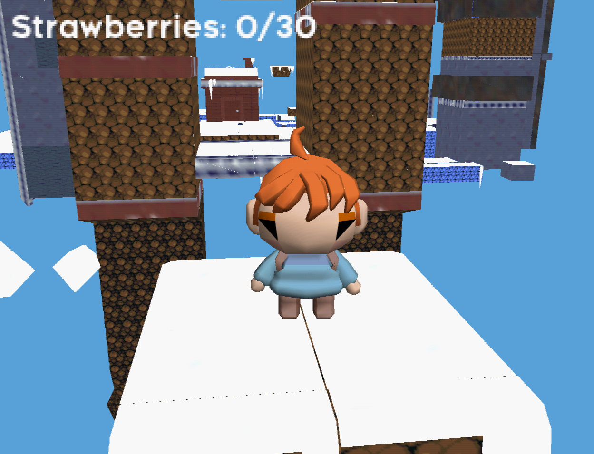

# Celeste 64 Demake

<p align="center"></p>

A Celeste64-inspired Nintendo 64 demake built with libdragon and tiny3d. The current build features an animated Madeline model, the Forsaken City A-side world, and movement with jumping, dashing, and wall climbing.

The project keeps gameplay code engine-light while the ROM layer handles N64 input, rendering, and streaming the baked world.

## Current status

Milestone 1: Baked level pipeline + first playable room

Completed:
- ROM boots, runs, and loads baked levels (TrenchBroom → `.map` → `.lvl` + `.colmesh`)
- Player moves/jumps/dashes on collision mesh
- Multiple rooms supported (first-room + full Forsaken City map-pack)
- Fall respawn to checkpoint
- Strawberry collection
- Material catalog with textured geometry
- **Full Forsaken City A-side `1.map`** as one traversable world: one global
  collision mesh + per-cell LVL2 visual rooms + map-pack v2 manifest
  (`tools/ogworld/` canonical IR → `MapRuntime` + `WorldCollision`)

In progress:
- Hardware traversal validation under Ares/Mupen64Plus (see
  `tests/rom_traversal_acceptance.md`)
- Verifying collision mesh queries under the Forsaken City map geometry

See [`.agents/map-creation.md`](.agents/map-creation.md) for the full end-to-end pipeline (author → bake → load).

## Interconnected map bake

The full A-side `1.map` is baked through the canonical world IR into one
global CMSH + per-cell LVL2 rooms + a map-pack v2 manifest:

```sh
make bake-forsaken-city
# or
python3 tools/bake_interconnected_map.py assets/og_converted/maps/1.map \
  --out-dir build/bake-fc-1200 --chunk-size 1200 --scale 0.2 \
  --mappack-id forsyken-city
```

The runtime (`MapRuntime` + `WorldCollision`) owns ONE global CMSH for the map
lifetime and one authoritative active visual room. All static queries resolve
through the global mesh; the active room exposes a compatibility pointer to
it. Render origins are per-cell centers so the full map's absolute coordinates
do not overflow the int16 fixed-point packing.

## Next build step

1. Add more entity types (hazards, traffic blocks, moving platforms).
3. Extend room graph / level transitions.
4. Introduce scene scripting (Pyrite64 planned, hand-authored for now).

## Host-side unit tests

Core physics and collision query logic can be tested on host without the N64 toolchain:

```sh
g++ -std=c++17 -Isrc/user \
  tests/level_loader_test.cpp \
  src/user/gameplay/world/level_loader.cpp \
  -o /tmp/level_loader_test && /tmp/level_loader_test

g++ -std=c++17 -Isrc/user \
  tests/coll_mesh_query_test.cpp \
  src/user/gameplay/physics/coll_mesh.cpp \
  -o /tmp/coll_mesh_query_test && /tmp/coll_mesh_query_test
```

Note: `tests/gameplay_smoke.cpp` depends on `<libdragon.h>` via entity dispatch and cannot compile on host. Verify the full gameplay loop on ROM instead.

## ROM build

After installing the libdragon N64 toolchain and Tiny3D:

```sh
./compile-rom.sh
```

Builds `madeline_cube_rom.z64` (libdragon + tiny3d):

- Player spawns on the active room (set by `kBakedLevelPath` in `gameplay_scene.cpp`)
- Baked level geometry from TrenchBroom `.map` files
- Textured faces from material catalog
- Collision mesh queries for floor/wall detection
- Analog movement, `A` jump, `B` air dash, fall respawn
- Strawberry collectibles

To author a new room, see [`.agents/map-creation.md`](.agents/map-creation.md) for the full pipeline (TrenchBroom → bake.py → runtime load).

## Reference stack

- Pyrite64 for editor/runtime integration
- libdragon underneath for N64 SDK/runtime
- tiny3d underneath for 3D rendering and future GLTF assets
