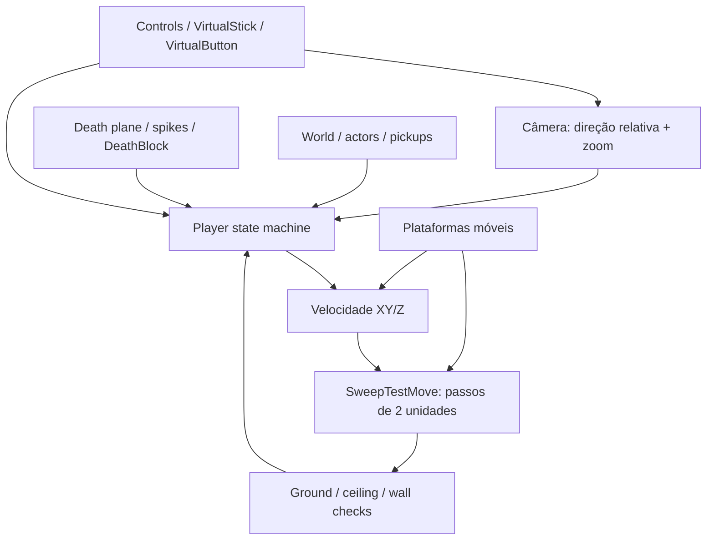

# Celeste 64 — Spec de controles e física

## 1. Escopo

Especificação reversa de `Celeste64`, baseada no branch `main` do repositório oficial em 29/08/2026.

Foco:

- controles padrão;
- ciclo de atualização do jogador;
- movimento terrestre e aéreo;
- pulo, dash, skid, escalada, wall jump, feather e molas;
- colisão, plataformas móveis, morte e respawn.

Valores usam unidades internas do jogo. Todas as atualizações dependentes de tempo usam `Time.Delta`.

Fontes principais: [`Player.cs`](https://github.com/EXOK/Celeste64/blob/main/Source/Actors/Player.cs), [`ControlsConfig.cs`](https://github.com/EXOK/Celeste64/blob/main/Source/Data/ControlsConfig.cs), [`Controls.cs`](https://github.com/EXOK/Celeste64/blob/main/Source/Data/Controls.cs).

## 2. Modelo mental



### Estados do jogador

Estados declarados em `Player`:

`Normal`, `Dashing`, `Skidding`, `Climbing`, `StrawbGet`, `FeatherStart`, `Feather`, `Respawn`, `Dead`, `StrawbReveal`, `Cutscene`, `Bubble`, `Cassette`.

Somente `Normal`, `Dashing`, `Skidding`, `Climbing`, `FeatherStart` e `Feather` têm comportamento de locomoção principal. Estados de interação/cutscene suspendem ou substituem a física normal.

## 3. Controles

### 3.1 Ações

| Ação    | Teclado padrão                                                                | Mouse                                             | Controle                                         |
| --------- | ------------------------------------------------------------------------------ | ------------------------------------------------- | ------------------------------------------------ |
| Mover     | WASD quando mouse controla câmera; setas quando teclado controla câmera      | —                                                | Analógico esquerdo                              |
| Câmera   | WASD quando teclado controla câmera                                           | Movimento do mouse quando mouse controla câmera  | Analógico direito                               |
| Pular     | `C`, `Space`                                                               | —                                                | `South` ou `North`                           |
| Dash      | `X`                                                                          | Botão esquerdo ou direito, no modo mouse-câmera | `West` ou `East`                             |
| Escalar   | `Z`, `V`, `LeftShift`, `RightShift`, `LeftControl`, `RightControl` | —                                                | Ombro esquerdo/direito; gatilho esquerdo/direito |
| Pausar    | `Enter`, `Escape`                                                          | —                                                | `Start`, `Guide`, `Back`                   |
| Confirmar | `C`                                                                          | Esquerdo, no modo mouse-câmera                   | `South` no Xbox; `East` no Nintendo          |
| Cancelar  | `X`                                                                          | Direito, no modo mouse-câmera                    | `East` no Xbox; `South` no Nintendo          |

Bindings são configuráveis em `controls.json`. `Jump` e `Dash` têm buffer de pressão de `0.1 s` no dispositivo virtual; `Climb` usa estado contínuo (`Down`).

### 3.2 Movimento relativo à câmera

1. Se não há entrada, vetor de movimento é zero.
2. `forward` vem de `(Camera.LookAt - Camera.Position).XY()`.
3. `side` é `forward` rotacionado 90°.
4. Entrada é invertida no eixo usado pelo jogo e normalizada.
5. Resultado:

```text
relativeInput = forward * input.Y + side * input.X
```

Quando entrada aponta quase exatamente para frente (`dot >= 0.985`), direção é fixada em `Vec2.UnitY` para evitar ruído analógico.

### 3.3 Câmera

- Rotação horizontal: `4 rad/s` multiplicado por `Time.Delta`.
- Zoom: eixo vertical altera distância em `1 unidade/s`.
- Distância normalizada é limitada a `[0, 1]`.
- Sem entrada, distância tende a múltiplos de `1/3`.
- Câmera usa `InvertCamera` independente nos eixos X/Y.
- Câmera fixa de fase substitui posição normal.
- Raycast impede câmera de atravessar parede e teto.

## 4. Ciclo de atualização
