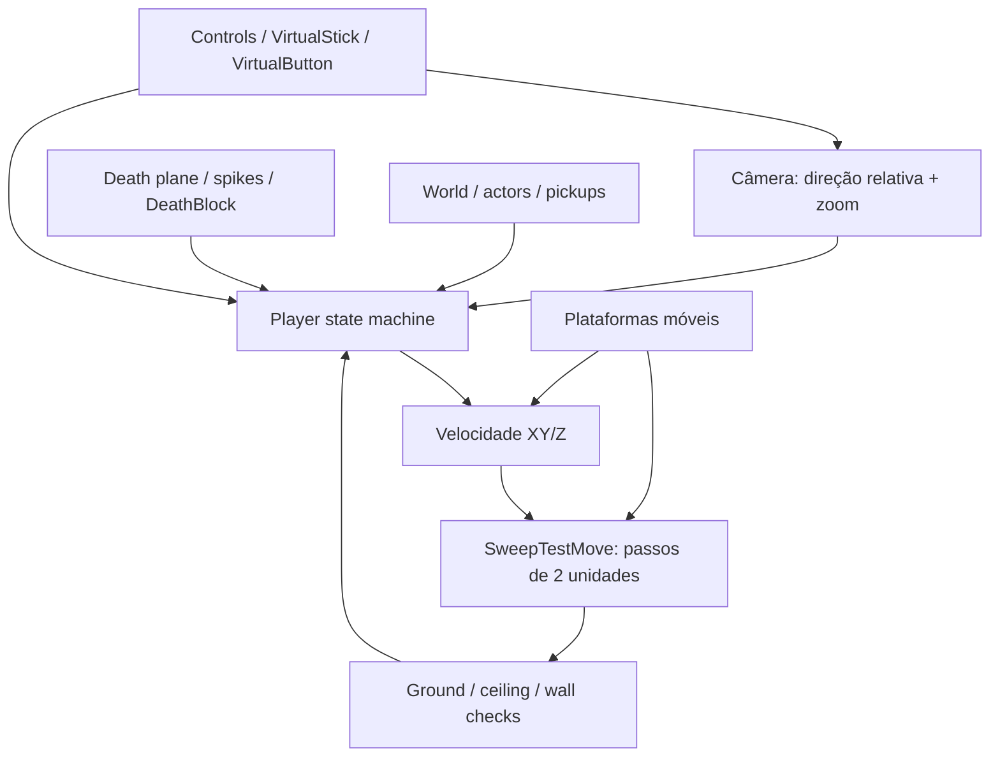

# Celeste 64 — Spec de controles e física

## 1. Escopo

Especificação reversa de `Celeste64`, baseada no branch `main` do repositório oficial em 29/08/2026.

Foco:

- controles padrão;
- ciclo de atualização do jogador;
- movimento terrestre e aéreo;
- pulo, dash, skid, escalada, wall jump, feather e molas;
- colisão, plataformas móveis, morte e respawn.

Valores usam unidades internas do jogo. Todas as atualizações dependentes de tempo usam `Time.Delta`.

Fontes principais: [`Player.cs`](https://github.com/EXOK/Celeste64/blob/main/Source/Actors/Player.cs), [`ControlsConfig.cs`](https://github.com/EXOK/Celeste64/blob/main/Source/Data/ControlsConfig.cs), [`Controls.cs`](https://github.com/EXOK/Celeste64/blob/main/Source/Data/Controls.cs).

## 2. Modelo mental



### Estados do jogador

Estados declarados em `Player`:

`Normal`, `Dashing`, `Skidding`, `Climbing`, `StrawbGet`, `FeatherStart`, `Feather`, `Respawn`, `Dead`, `StrawbReveal`, `Cutscene`, `Bubble`, `Cassette`.

Somente `Normal`, `Dashing`, `Skidding`, `Climbing`, `FeatherStart` e `Feather` têm comportamento de locomoção principal. Estados de interação/cutscene suspendem ou substituem a física normal.

## 3. Controles

### 3.1 Ações

| Ação    | Teclado padrão                                                                | Mouse                                             | Controle                                         |
| --------- | ------------------------------------------------------------------------------ | ------------------------------------------------- | ------------------------------------------------ |
| Mover     | WASD quando mouse controla câmera; setas quando teclado controla câmera      | —                                                | Analógico esquerdo                              |
| Câmera   | WASD quando teclado controla câmera                                           | Movimento do mouse quando mouse controla câmera  | Analógico direito                               |
| Pular     | `C`, `Space`                                                               | —                                                | `South` ou `North`                           |
| Dash      | `X`                                                                          | Botão esquerdo ou direito, no modo mouse-câmera | `West` ou `East`                             |
| Escalar   | `Z`, `V`, `LeftShift`, `RightShift`, `LeftControl`, `RightControl` | —                                                | Ombro esquerdo/direito; gatilho esquerdo/direito |
| Pausar    | `Enter`, `Escape`                                                          | —                                                | `Start`, `Guide`, `Back`                   |
| Confirmar | `C`                                                                          | Esquerdo, no modo mouse-câmera                   | `South` no Xbox; `East` no Nintendo          |
| Cancelar  | `X`                                                                          | Direito, no modo mouse-câmera                    | `East` no Xbox; `South` no Nintendo          |

Bindings são configuráveis em `controls.json`. `Jump` e `Dash` têm buffer de pressão de `0.1 s` no dispositivo virtual; `Climb` usa estado contínuo (`Down`).

### 3.2 Movimento relativo à câmera

1. Se não há entrada, vetor de movimento é zero.
2. `forward` vem de `(Camera.LookAt - Camera.Position).XY()`.
3. `side` é `forward` rotacionado 90°.
4. Entrada é invertida no eixo usado pelo jogo e normalizada.
5. Resultado:

```text
relativeInput = forward * input.Y + side * input.X
```

Quando entrada aponta quase exatamente para frente (`dot >= 0.985`), direção é fixada em `Vec2.UnitY` para evitar ruído analógico.

### 3.3 Câmera

- Rotação horizontal: `4 rad/s` multiplicado por `Time.Delta`.
- Zoom: eixo vertical altera distância em `1 unidade/s`.
- Distância normalizada é limitada a `[0, 1]`.
- Sem entrada, distância tende a múltiplos de `1/3`.
- Câmera usa `InvertCamera` independente nos eixos X/Y.
- Câmera fixa de fase substitui posição normal.
- Raycast impede câmera de atravessar parede e teto.

## 4. Ciclo de atualização

## Demake implementation (og-mover-overhaul)

O demake (N64, +Y up) implementa o mover único do OG com `MoveService`
(`src/user/gameplay/player/player_movement.{hpp,cpp}`), chamado uma vez por tick
pelo `PlayerController::MovePhase`. Substituiu o antigo `PlayerMotor`
(desligado no Inc 2), que mantinha quatro caminhos de reparo paralelos — a causa
da queda de clipping em paredes e pisos.

Mapeamento mover (OG Z-up → demake +Y-up, âncora nos pés: `feet =
center.y - player_half_height`):

| OG (Player.cs)            | Demake                                                        |
|---------------------------|---------------------------------------------------------------|
| `SweepTestMove` (642-660) | `MoveService::SweepMove` — subpassos de 2 u + `Popout`         |
| `Popout` (669-718)        | `MoveService::Popout` — ground → ceiling → wall (waist+head)   |
| `GroundCheck` (2280-2295) | ray desce de `feet+5`, len `5.01`, gate `FloorNormalCheck`     |
| `CeilingCheck` (2297-2308)| ray sobe de `feet+1`, altura `12`                              |
| `SolidWallCheckNearest` (World.cs 556-571) | `QueryWallPushout` (waist `feet+3`, head `feet+10`, raio 3) |
| ground snap (399-406)     | `GroundSnap` — ray desce `5`, gate cooldown `0.10` gated field  |

Remoções:
- snap de chão de 50 u (`PlayerMotorConfig::ground_snap_distance = 50`) → ray
  de `5` do OG (gate no campo existente `ground_snap_cooldown_remaining`).
- verificações de contato dentro dos subpassos → `Popout` dentro do `SweepMove`.
- gates paralelos de piso por esfera → ray `GroundCheck` único com o
  `FloorNormalCheck` do OG.

### Ledger de desvios
1. kill plane `-200` (mundo do demake) vs OG `-100` — diferença de mundo, não
   de feel.
2. hitstop do dash é local do controlador (OG congela o mundo).
3. zoom da câmera `1.8/1.0` — desvio pré-existente documentado.
4. gate de entrada de escalada por facing-dot `>= 0.5` — OG não tem dot-gate.
5. confirmação de mantle em 2 ticks (OG instantânea).
6. raio de colisão de escalada 3 com raio de visibilidade de entrada 5
   (desvio documentado do climb-parity-3, mantido).
7. distância de repouso em parede no estado Normal agora é 3 (OG WallPushoutDist)
   — mudou do raio antigo de tangência 5 do motor (decisão og-mover-overhaul,
   fixada no fixture (e) de move_service_smoke).
8. ground snap: ray desce 5 com cooldown `0.10` — mecanismo do próprio OG
   (listado por completude, não é desvio).
9. clamps de velocidade de plataforma `Z [0,180]` / `XY 300` (OG
   `AddPlatformVelocity`).

Sem clipping por construção: toda tick termina num estado "popped-out"
(`SweepMove` + `Popout(false)` final), de modo que a posição fica fora de toda
face de parede.

### Revisão pós-implementação (2026-08-29)
Correções aplicadas na revisão do PR:
- **Cancel ground snap (OG Player.cs:722)**: todo local de decolagem (pulo,
  walljump direcional + neutral, dash, skid-jump, mantle) arma
  `ground_snap_cooldown = 0.10` — antes o setter faltava e o snap de 5 u
  comia o início de cada pulo.
- **Faces MAT_DEATH voltaram a matar**: `MoveService::Popout` sinaliza
  `PlayerState::death_contact` em qualquer face reparada com material de
  morte; a cena combinou com o kill plane (`motor_result.death`).
- `MovementProfile` deletado — uma única `MovementConfig` (o `jump_buffer_time`
  0.08 fantasma foi embora junto).
- Um único `MoveService` em produção: `PlayerController::Mover()` é a instância
  compartilhada por spawn, respawn e ticks.
