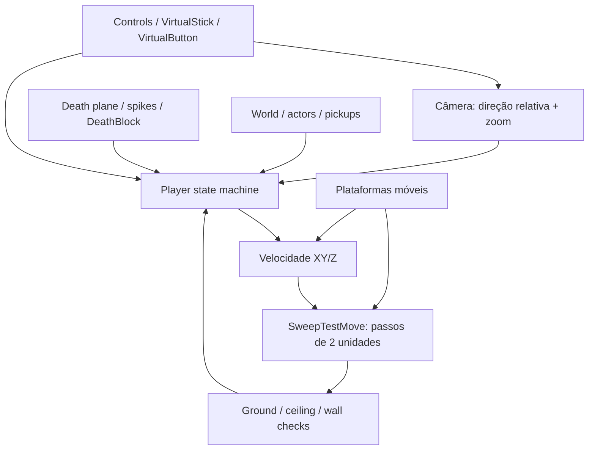

# Celeste 64 — Spec de controles e física

## 1. Escopo

Especificação reversa de `Celeste64`, baseada no branch `main` do repositório oficial em 29/08/2026.

Foco:

- controles padrão;
- ciclo de atualização do jogador;
- movimento terrestre e aéreo;
- pulo, dash, skid, escalada, wall jump, feather e molas;
- colisão, plataformas móveis, morte e respawn.

Valores usam unidades internas do jogo. Todas as atualizações dependentes de tempo usam `Time.Delta`.

Fontes principais: [`Player.cs`](https://github.com/EXOK/Celeste64/blob/main/Source/Actors/Player.cs), [`ControlsConfig.cs`](https://github.com/EXOK/Celeste64/blob/main/Source/Data/ControlsConfig.cs), [`Controls.cs`](https://github.com/EXOK/Celeste64/blob/main/Source/Data/Controls.cs).

## 2. Modelo mental



### Estados do jogador

Estados declarados em `Player`:

`Normal`, `Dashing`, `Skidding`, `Climbing`, `StrawbGet`, `FeatherStart`, `Feather`, `Respawn`, `Dead`, `StrawbReveal`, `Cutscene`, `Bubble`, `Cassette`.

Somente `Normal`, `Dashing`, `Skidding`, `Climbing`, `FeatherStart` e `Feather` têm comportamento de locomoção principal. Estados de interação/cutscene suspendem ou substituem a física normal.

## 3. Controles

### 3.1 Ações

| Ação    | Teclado padrão                                                                | Mouse                                             | Controle                                         |
| --------- | ------------------------------------------------------------------------------ | ------------------------------------------------- | ------------------------------------------------ |
| Mover     | WASD quando mouse controla câmera; setas quando teclado controla câmera      | —                                                | Analógico esquerdo                              |
| Câmera   | WASD quando teclado controla câmera                                           | Movimento do mouse quando mouse controla câmera  | Analógico direito                               |
| Pular     | `C`, `Space`                                                               | —                                                | `South` ou `North`                           |
| Dash      | `X`                                                                          | Botão esquerdo ou direito, no modo mouse-câmera | `West` ou `East`                             |
| Escalar   | `Z`, `V`, `LeftShift`, `RightShift`, `LeftControl`, `RightControl` | —                                                | Ombro esquerdo/direito; gatilho esquerdo/direito |
| Pausar    | `Enter`, `Escape`                                                          | —                                                | `Start`, `Guide`, `Back`                   |
| Confirmar | `C`                                                                          | Esquerdo, no modo mouse-câmera                   | `South` no Xbox; `East` no Nintendo          |
| Cancelar  | `X`                                                                          | Direito, no modo mouse-câmera                    | `East` no Xbox; `South` no Nintendo          |

Bindings são configuráveis em `controls.json`. `Jump` e `Dash` têm buffer de pressão de `0.1 s` no dispositivo virtual; `Climb` usa estado contínuo (`Down`).

### 3.2 Movimento relativo à câmera

1. Se não há entrada, vetor de movimento é zero.
2. `forward` vem de `(Camera.LookAt - Camera.Position).XY()`.
3. `side` é `forward` rotacionado 90°.
4. Entrada é invertida no eixo usado pelo jogo e normalizada.
5. Resultado:

```text
relativeInput = forward * input.Y + side * input.X
```

Quando entrada aponta quase exatamente para frente (`dot >= 0.985`), direção é fixada em `Vec2.UnitY` para evitar ruído analógico.

### 3.3 Câmera

- Rotação horizontal: `4 rad/s` multiplicado por `Time.Delta`.
- Zoom: eixo vertical altera distância em `1 unidade/s`.
- Distância normalizada é limitada a `[0, 1]`.
- Sem entrada, distância tende a múltiplos de `1/3`.
- Câmera usa `InvertCamera` independente nos eixos X/Y.
- Câmera fixa de fase substitui posição normal.
- Raycast impede câmera de atravessar parede e teto.

## 4. Ciclo de atualização

## Demake implementation (og-mover-overhaul)

O demake (N64, +Y up) implementa o mover único do OG com `MoveService`
(`src/user/gameplay/player/player_movement.{hpp,cpp}`), chamado uma vez por tick
pelo `PlayerController::MovePhase`. Substituiu o antigo `PlayerMotor`
(desligado no Inc 2), que mantinha quatro caminhos de reparo paralelos — a causa
da queda de clipping em paredes e pisos.

Mapeamento mover (OG Z-up → demake +Y-up, âncora nos pés: `feet =
center.y - player_half_height`):

| OG (Player.cs)            | Demake                                                        |
|---------------------------|---------------------------------------------------------------|
| `SweepTestMove` (642-660) | `MoveService::SweepMove` — subpassos de 2 u + `Popout`         |
| `Popout` (669-718)        | `MoveService::Popout` — ground → ceiling → wall (waist+head)   |
| `GroundCheck` (2280-2295) | ray desce de `feet+5`, len `5.01`, gate `FloorNormalCheck`     |
| `CeilingCheck` (2297-2308)| ray sobe de `feet+1`, altura `12`                              |
| `SolidWallCheckNearest` (World.cs 556-571) | `QueryWallPushout` (waist `feet+3`, head `feet+10`); gameplay wall radius 3, climb radius 3 |
| ground snap (399-406)     | `GroundSnap` — ray desce `5`, gate cooldown `0.10` gated field  |

Remoções:
- snap de chão de 50 u (`PlayerMotorConfig::ground_snap_distance = 50`) → ray
  de `5` do OG (gate no campo existente `ground_snap_cooldown_remaining`).
- verificações de contato dentro dos subpassos → `Popout` dentro do `SweepMove`.
- gates paralelos de piso por esfera → ray `GroundCheck` único com o
  `FloorNormalCheck` do OG.

### Ledger de desvios
1. kill plane `-200` (mundo do demake) vs OG `-100` — diferença de mundo, não
   de feel.
2. hitstop do dash é local do controlador (OG congela o mundo): a velocidade
   OG do dash é aplicada no frame de aceitação e esse primeiro deslocamento
   ocorre antes do hitstop local; os ticks congelados seguintes não consomem
   os 0.20 s ativos do dash.
3. zoom da câmera `1.8/1.0` — desvio pré-existente documentado.
4. o gate de entrada por facing-dot `>= 0.5` foi removido: OG usa facing
   apenas para ordenar faces candidatas; direção de movimento, quando existe,
   é comparada com a normal da face realmente consultada.
5. confirmação de mantle em 2 ticks (OG instantânea).
6. escalada mantém âncora de 3 e probes de sustentação/entrada de 4. O teste
   de parede usa `ClimbCheckDist` OG também para walljump; mesh bounds não
   alteram o alcance de movimento.
7. repouso de parede no estado Normal é 3 (OG `WallPushoutDist`); climb também
   usa 3. O static model preserva escala 1.0: raio horizontal medido
   1.721 × 5 = 8.61 e altura 4.372 × 5 = 21.86. O renderer calcula offset
   visual separado para manter pelo menos 0.5 u de gap sem inflar o shell de
   colisão. `player_half_height=11.25` é o mapeamento centro→pés, não raio de
   contato.
8. ground snap: ray desce 5 com cooldown `0.10` — mecanismo do próprio OG
   (listado por completude, não é desvio).
9. clamps de velocidade de plataforma `Z [0,180]` / `XY 300` (OG
   `AddPlatformVelocity`).
10. **Mola (Inc 3, OG Player.cs:919-937):** implementada como OG — handler
    `PlayerController::Spring` sai de Climbing/Dashing para Normal, snap na
    placa (`y+3` escalar, XY approach 4), lançamento `spring_jump_speed=160`
    com hold `0.30` (auto_jump), zera momentum XY (approach 30), refila o dash
    (`Max(dashes,1)`) e cancela o ground snap. Constantes únicas em
    `movement_config.hpp`. `SpringActor` ganhou o cooldown de bordo do OG
    (`tCooldown = 1.0 s` — OG Spring.cs) para não relançar a cada tick; o
    raio de pickup é 16 (OG `PickupRadius`). Sem desvios conhecidos.
11. **Gate de frente de escalada independente de winding (Inc 4):** o gate
    antigo (`signed_dist < 0`, lendo a normal crua do winding) rejeitava TODO
    paredão do mapa real porque o winding do bake de colisão é REVERSO (normais
    cruas apontam PARA DENTRO das paredes) — o grab nunca disparava em device
    (0 linhas `[climb] START`). O gate grip/entry agora é independente de
    winding: (a) banda de altura (extensão Y da face deve sobrepor o corpo
    `[waist-3, waist+7]`) e (b) clearance de topo — se houver sólido a até 8
    acima do probe de cintura, a face é beirada de beiral/sob-telhado e o grab
    é rejeitado (guarda do auto-latch "debaixo do beiral"). Medido no mapa
    real: 0% das amostras junto a paredes têm sólido a <6 acima — não rejeita
    nada legítimo. O caminho popout (`orient_to_point=false`) não mudou
    (semântica OG de pushout intacta). A verificação do probe: parede de
    winding reverso escala sustentadamente; sob-beiral NÃO agarra; sem Z não
    agarra. Grab em device: `[climb] START` dispara em paredes reais com Z +
    direção; sem Z → 0 linhas (sem auto-latch).
12. **Envelope do modelo estático:** player GLB tem pivô nos pés, raio horizontal
    máximo 1.721 e altura 4.372 antes da escala base 5. O modelo em escala 1.0
    mede raio 8.61 e altura 21.86; não é dimensões físicas. A âncora física
    continua em 3 e o render calcula offset em qualquer estado para manter gap
    visual de 0.5 perto de paredes; durante climbing também considera ambos os
    planos durante corner ease.
    `[input-trace]` opcional grava stick bruto, ações, posição, velocidade e
    contatos de parede/teto por tick; desligado por padrão.
13. **Ceiling popout usa âncora de pés do OG:** OG define `Position.Z = hit.Z - 12`;
    como o demake guarda `PlayerState.position` no centro, converte para
    `center.y = hit.y - 12 + half_height`. O mover antes atribuía o resultado
    dos pés diretamente ao centro e derrubava a posição por um `half_height`.
14. **Arestas finitas de canto:** o raio externo parte do lado de Madeline e
    adota apenas face frontal alcançável. Candidatos do lado oposto à parede
    antiga são rejeitados; no fim de uma parede sem continuação, ela solta a
    pegada em vez de atravessar a rocha.
15. **Wall-jump ao sair da escalada:** OG `WallJump()` sempre define a mesma
    velocidade de saída (`WallJumpXYSpeed = 1.3 × MaxSpeed`, `JumpSpeed` no
    eixo vertical). Removido o perfil divergente `40/105` usado só quando o
    stick estava neutro; manter ou não outro botão direcional não pode trocar
    a trajetória do mesmo wall-jump.
16. **Dash-jump tardio e impulso de plataforma:** OG `DashJump()` restaura
    `coyoteZ` antes do lançamento e aplica `AddPlatformVelocity(false)`. O
    demake restaura `contact.coyote_height`; todos os impulsos equivalentes
    consomem carry armazenado com limites OG de vertical `[0,180]` e horizontal
    `300`. O smoke cobre dash-jump já fora da borda, altura restaurada e carry
    limitado/consumido.
17. **Rider de plataforma móvel:** o `GroundHit.owner_id` mantém a superfície
    de suporte entre ticks. Antes da atualização de input/estado, o player
    recebe o deslocamento da plataforma pelo mesmo `SweepMove` e armazena sua
    velocidade durante a janela OG de `0.10 s`; saltos consomem esse impulso
    com os mesmos limites. `surface_parity_smoke` valida ownership, movimento
    sem teleporte e carry no salto.
18. **Grab lateral de parede:** o vetor de facing apenas ordena faces
    candidatas, como no OG; não rejeita uma parede válida por um dot threshold.
    Se houver direção de movimento, o input precisa apontar para dentro da
    normal da face consultada; input neutro continua válido com Z pressionado.
    O smoke aceita grab lateral e rejeita movimento para longe da parede. O
    falso auto-grab anterior coincidiu com `z=1` bruto em repouso no Ares; não
    estreitar a física para compensar um binding externo preso.

Sem clipping por construção: toda tick termina num estado "popped-out"
(`SweepMove` + `Popout(false)` final), de modo que a posição fica fora de toda
face de parede.

### Revisão pós-implementação (2026-08-29)
Correções aplicadas na revisão do PR:
- **Cancel ground snap (OG Player.cs:722)**: todo local de decolagem (pulo,
  walljump direcional + neutral, dash, skid-jump, mantle) arma
  `ground_snap_cooldown = 0.10` — antes o setter faltava e o snap de 5 u
  comia o início de cada pulo.
- **Faces MAT_DEATH voltaram a matar**: `MoveService::Popout` sinaliza
  `PlayerState::death_contact` em qualquer face reparada com material de
  morte; a cena combinou com o kill plane (`motor_result.death`).
- `MovementProfile` deletado — uma única `MovementConfig` (o `jump_buffer_time`
  0.08 fantasma foi embora junto).
- Um único `MoveService` em produção: `PlayerController::Mover()` é a instância
  compartilhada por spawn, respawn e ticks.
